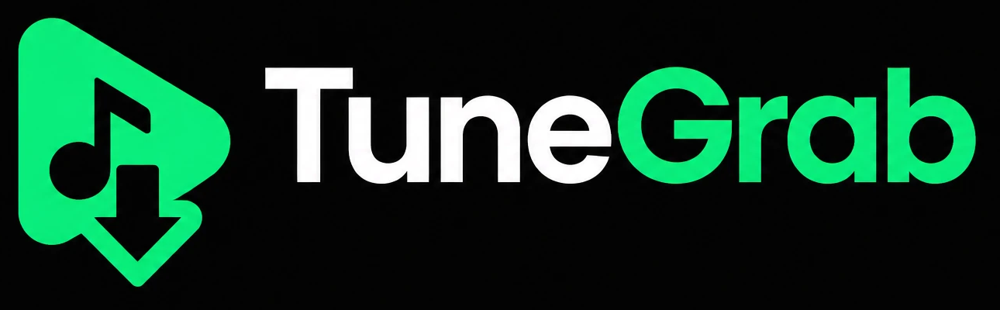
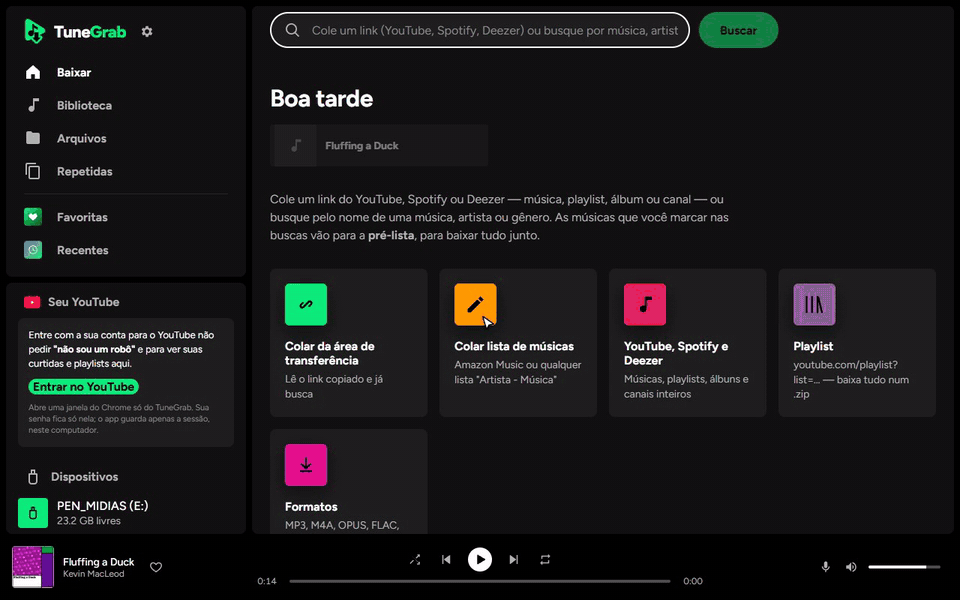
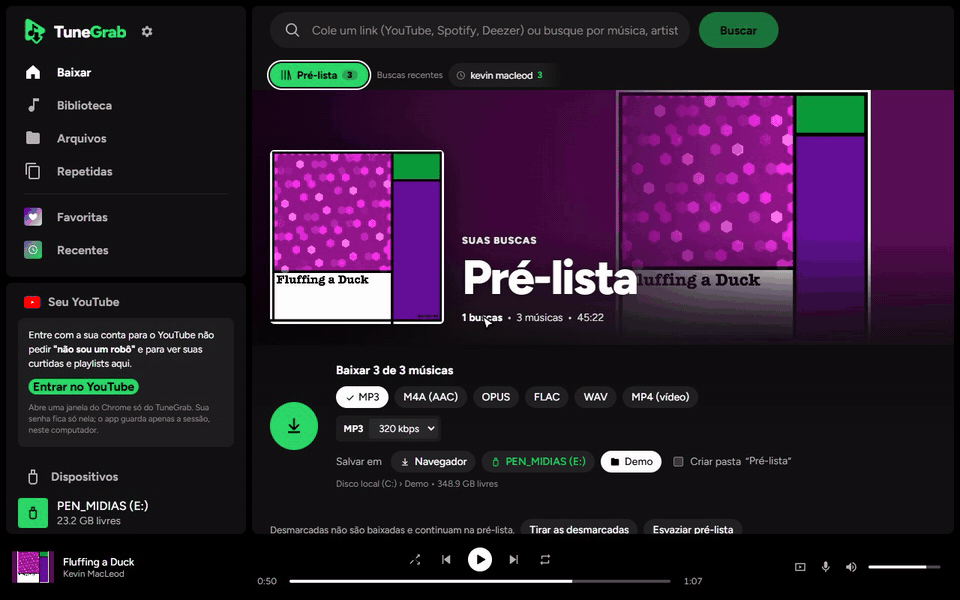
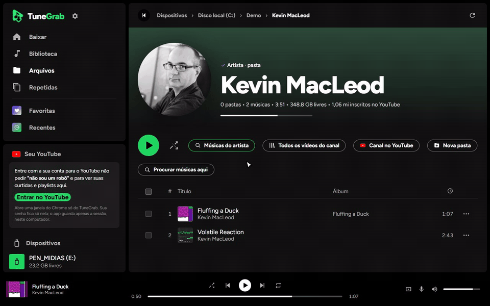

<p align="center">
  
</p>

<p align="center">
  A music player and organizer for Windows: save straight to a <b>USB stick</b> (for the car stereo),
  organize your collection, find duplicates and listen with <b>synced lyrics</b>.<br>
  Imports Spotify and Deezer playlists, and downloads public YouTube videos through <a href="https://github.com/yt-dlp/yt-dlp">yt-dlp</a>.
  Free software (GPL-3.0), built with Nuxt 4, Electron and FFmpeg.
</p>

<p align="center">
  <a href="https://github.com/jeanevertonoficial/TuneGrab/releases/latest/download/TuneGrab-Setup.exe"><b>⬇️ Download for Windows</b></a>
  &nbsp;·&nbsp; <a href="README.md">Português</a>
  &nbsp;·&nbsp; <a href="#legal-notice">Legal notice</a>
  &nbsp;·&nbsp; <a href="#code-signing-policy">Code signing policy</a>
</p>

<p align="center">
  
</p>

> The interface is in Brazilian Portuguese. The full documentation is in [README.md](README.md); this page is a summary.

## Install

1. Download **[TuneGrab-Setup.exe](https://github.com/jeanevertonoficial/TuneGrab/releases/latest/download/TuneGrab-Setup.exe)** (Windows 10/11, 64-bit, ~150 MB).
2. Run it. It installs per user, **no admin rights needed**. The server, yt-dlp and FFmpeg are bundled — no Node, Python or terminal.
3. Windows may warn about an "unknown publisher" (the installer is not code-signed yet): **More info → Run anyway**.

The app starts with Windows, lives in the system tray (closing the window keeps downloads running) and
**updates itself**: when a new release is out it shows "Atualizar agora" (update now), downloads it, verifies the
SHA-512 and reopens.

## Features

**Get music**
- Paste a YouTube link (song, playlist, Mix, whole channel split into Videos / Shorts / Live) or a Spotify / Deezer
  track, album or playlist. Each Spotify/Deezer track is matched to the official YouTube upload (duration checked) and
  saved with the original title, artist, album and cover.
- Or search by name, tick songs across several searches into a **pre-list**, then download them all at once.
- Preview before downloading (audio or the 360p video).
- Formats: **MP3** (128–320 kbps), **M4A**, **OPUS**, **FLAC**, **WAV**, **MP4** (up to 1080p, VP9 or H.264 for old car stereos).
- Cover, tags and **lyrics** written into the file. "Already downloaded" badges (✓ MP3 / ✓ MP4) and resumable downloads.

**USB stick and files**
- USB drives are detected automatically; save directly to them or to any folder (playlists get their own folder).
- **Format a USB stick** (FAT32, exFAT or NTFS) — only removable disks, with confirmation.
- File manager: create, rename, move, copy, delete, and edit title/artist/album without re-encoding.
- **Artist folders** show the artist's YouTube channel photo and link, and find new songs to download into that folder.
- **Library** of every song on your drives, and a **Duplicates** finder (identical by hash, or the same song in another format).



**Player**
- Queue, shuffle, repeat, media keys, keyboard shortcuts, favorites and recently played.
- **Synced lyrics** (from the file or [LRCLIB](https://lrclib.net)); they shrink to a corner card while you browse.
- Video in a mini panel, expanded or fullscreen, and a **floating always-on-top window** when the app is minimized —
  the audio never moves, so minimizing and restoring never pauses or skips.
- Optional guided **YouTube sign-in** (your own account) to avoid "confirm you're not a bot" and to browse your liked
  videos, Watch Later, subscriptions and playlists.



Everything stays on your computer (`%APPDATA%\TuneGrab`). The internal server only listens on `127.0.0.1`.

## Code signing policy

Free code signing provided by [SignPath.io](https://about.signpath.io), certificate by [SignPath Foundation](https://signpath.org).

> Status: application to the SignPath Foundation open-source program in progress. Until it is approved, the installer
> is unsigned (Windows shows "unknown publisher").

- The installer is built **on GitHub's servers** from this repository ([workflow](.github/workflows/instalador.yml)),
  and each release is signed only after **manual approval**.
- Autor, revisor e aprovador / Committers, reviewers and approvers: [Jean Everton](https://github.com/jeanevertonoficial) (mantenedor / maintainer)
- Third-party components (FFmpeg, yt-dlp, Electron) are bundled as published by their projects — see
  [THIRD-PARTY-NOTICES.md](THIRD-PARTY-NOTICES.md).

### Privacy policy

This program will not transfer any information to other networked systems unless specifically requested by the user
or the person installing or operating it. On the user's actions it connects to **YouTube** (search, preview, download,
optional sign-in), **Spotify** and **Deezer** (to read a pasted playlist) and **LRCLIB** (lyrics). The only automatic
connection is the **update check on GitHub** (at startup and every 6 hours), which sends no personal data and can be
turned off in the tray menu ("Procurar atualizações sozinho"). There are no TuneGrab servers. The privacy policies of
those services apply when you use them.


## Run from source

```bash
npm install        # also downloads yt-dlp
npm run dev        # http://localhost:3000
npm run dist       # builds release/TuneGrab-Setup-<version>.exe
npm run release    # publishes the version in package.json as a GitHub release (installed apps update themselves)
```

## Contributing

Issues and pull requests are welcome — see [CONTRIBUTING.md](CONTRIBUTING.md).

## License

TuneGrab is free software under the **GNU GPL-3.0-or-later** ([LICENSE](LICENSE)). The installer bundles FFmpeg
(GPL-3.0) and yt-dlp (Unlicense); every bundled component and its license is listed in
[THIRD-PARTY-NOTICES.md](THIRD-PARTY-NOTICES.md).

## Legal notice

- TuneGrab is a tool for **personal use**. Only download content you have the right to download: your own, under a
  free license (e.g. Creative Commons), in the public domain, or with the rights holder's permission.
- Respect copyright and the terms of service of the platforms you use. You are responsible for what you download.
- The project **does not host or distribute** any music or video and **does not circumvent DRM**: from Spotify and
  Deezer it only reads the track list (title, artist, duration, cover); audio comes from public YouTube videos via yt-dlp.
- TuneGrab is **not affiliated** with YouTube, Google, Spotify, Deezer or Amazon. Their names are used only to describe
  compatibility and belong to their owners.
- The demo GIFs only use free-licensed music: "Fluffing a Duck", "Volatile Reaction" and "Garden Music" by Kevin MacLeod
  ([incompetech.com](https://incompetech.com)), licensed under [Creative Commons: By Attribution 4.0](https://creativecommons.org/licenses/by/4.0/).
- The software is provided "as is", without warranty (see the [license](LICENSE)).
