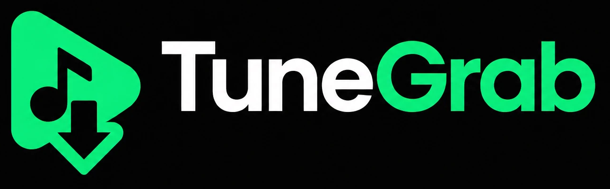
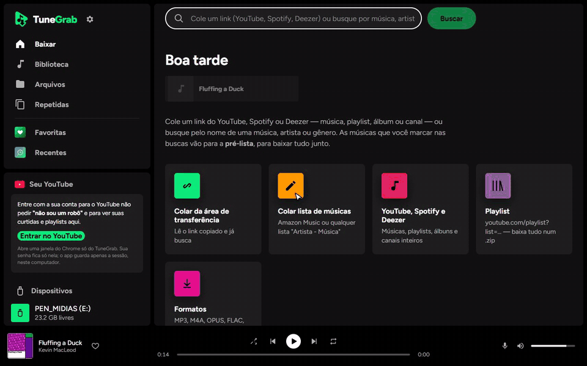
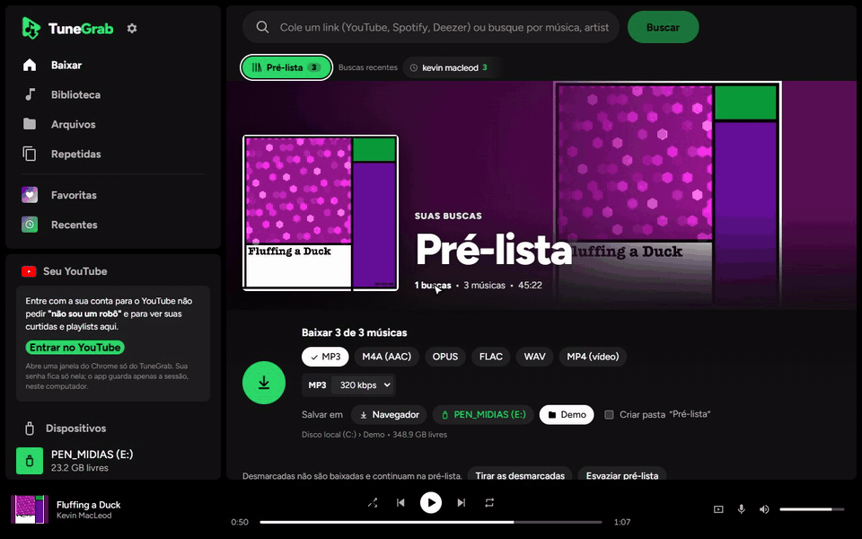
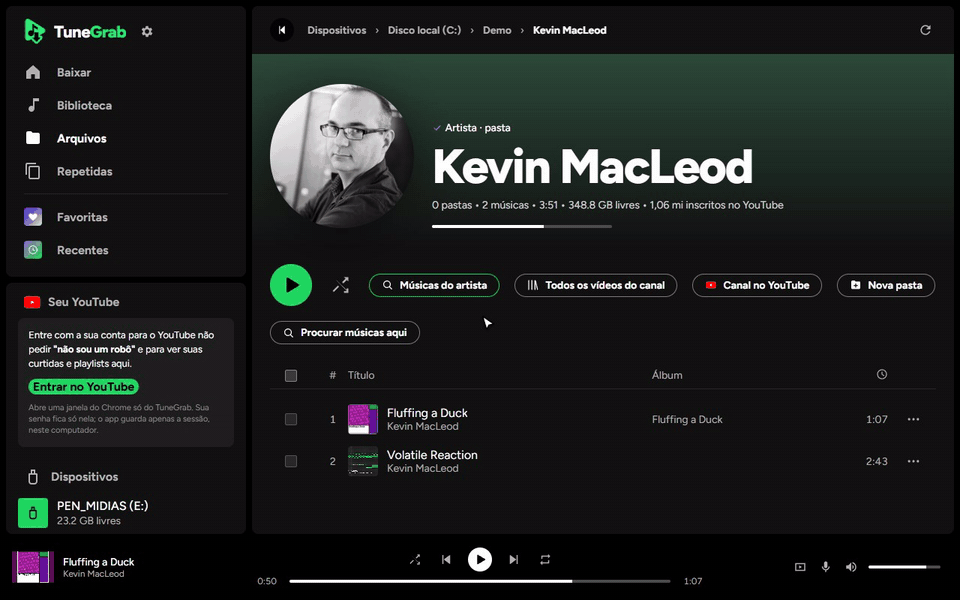

<p align="center">
  
</p>

<p align="center">
  Player e organizador de música para Windows: salve direto no <b>pendrive</b> (para o som do carro),
  organize sua coleção, encontre repetidas e ouça com <b>letra sincronizada</b>.<br>
  Importa listas do Spotify e da Deezer, e baixa vídeos públicos do YouTube via <a href="https://github.com/yt-dlp/yt-dlp">yt-dlp</a>.
  Software livre (GPL-3.0), feito com Nuxt 4, Electron e FFmpeg.
</p>

<p align="center">
  <a href="https://github.com/jeanevertonoficial/TuneGrab/releases/latest/download/TuneGrab-Setup.exe"><b>⬇️ Baixar para Windows</b></a>
  &nbsp;·&nbsp; <a href="README.en.md">English</a>
  &nbsp;·&nbsp; <a href="#aviso-legal">Aviso legal</a>
  &nbsp;·&nbsp; <a href="#política-de-assinatura-de-código-code-signing-policy">Code signing policy</a>
</p>

<p align="center">
  
</p>

---

## Sumário

- [Programa para Windows (recomendado)](#programa-para-windows-recomendado)
- [Como rodar pelo código](#como-rodar-pelo-código)
- [Instalar como aplicativo (PWA)](#instalar-como-aplicativo-pwa)
- [Recursos](#recursos)
  - [Baixar](#baixar) · [Busca por nome e pré-lista](#busca-por-nome-e-pré-lista) · [Ouvir (e ver) antes de baixar](#ouvir-e-ver-antes-de-baixar)
  - [Conta do YouTube](#conta-do-youtube-login-guiado) · [Letras](#letras-sincronizadas)
  - [Pendrive e pastas](#salvar-direto-no-pendrive-ou-em-qualquer-pasta) · [Arquivos](#gerenciador-de-arquivos) · [Biblioteca](#biblioteca) · [Repetidas](#repetidas) · [Formatar pendrive](#formatar-pendrive)
  - [Player e vídeo](#player-e-vídeo) · [Favoritas e recentes](#favoritas-e-tocadas-recentemente) · [Continua de onde parou](#continua-de-onde-parou)
- [No celular e no carro](#no-celular-e-no-carro)
- [Seus dados e privacidade](#seus-dados-e-privacidade)
- [Solução de problemas](#solução-de-problemas)
- [Manutenção](#manutenção)
- [Estrutura do código](#estrutura-do-código)
- [Contribuir](#contribuir)
- [Créditos e licença](#créditos-e-licença)
- [Política de assinatura de código (Code signing policy)](#política-de-assinatura-de-código-code-signing-policy)
- [Aviso legal](#aviso-legal)

---

## Programa para Windows (recomendado)

O TuneGrab vira um **programa instalável** (`TuneGrab-Setup-x.y.z.exe`, ~150 MB) — feito com Electron, como o Spotify e o Discord.
Não precisa de Node, terminal nem `npm run dev`: o servidor, o **yt-dlp** e o **ffmpeg** vão dentro.

**⬇️ Baixar:** [última versão do instalador](https://github.com/jeanevertonoficial/TuneGrab/releases/latest/download/TuneGrab-Setup.exe)
(ou veja todas em [Releases](https://github.com/jeanevertonoficial/TuneGrab/releases)). Baixe, abra e pronto —
instala só para o seu usuário, sem pedir administrador. O Windows pode avisar "editor desconhecido"
(o instalador não tem assinatura paga): **Mais informações → Executar assim mesmo**.

**Sempre no ar:**

- **Inicia com o Windows** (escondido, perto do relógio) — o servidor já fica pronto. Dá para desligar no menu do ícone.
- **Fechar a janela não desliga:** o app continua na bandeja (perto do relógio), terminando os downloads.
  Clique no ícone para abrir de novo; **botão direito → Sair** para fechar de vez.
- Com o app rodando, **http://localhost:47800** também abre no Chrome (e dá para instalar como PWA por lá).
- Se o servidor interno cair, ele religa sozinho.

**Gerar o instalador:**

```bash
npm run dist     # cria release/TuneGrab-Setup-<versão>.exe
npm run desktop  # testa o programa sem instalar
```

Instalação por usuário (sem pedir administrador), em `%LOCALAPPDATA%\Programs\TuneGrab`, com atalhos na área de trabalho e no
menu Iniciar. Os dados ficam em **`%APPDATA%\TuneGrab`** (veja [Seus dados](#seus-dados-e-privacidade)) e continuam lá ao atualizar
ou desinstalar.

**Atualizações pelo próprio app:** o programa confere o GitHub ao abrir e a cada 6 horas. Quando sai versão nova aparece
o aviso **"Nova versão do TuneGrab"** com **Atualizar agora**: ele baixa o instalador, confere se o arquivo veio inteiro
(sha512), instala sozinho e abre o TuneGrab de novo — histórico, login e preferências continuam. Também dá para procurar
pelo menu do ícone perto do relógio (**Procurar atualizações**). Downloads em andamento continuam depois, de onde pararam.

**Publicar uma versão nova** (para os programas instalados receberem o aviso):

```bash
# 1. aumente "version" no package.json (ex.: 1.0.1 -> 1.0.2)
npm run release              # gera o instalador e cria a release v1.0.2 no GitHub
npm run release -- notas.md  # o mesmo, com um arquivo de novidades
```

> A versão publicada na Vercel (ou em qualquer nuvem) só mostra a interface: pendrive, login e downloads precisam rodar
> **no seu computador**.

## Como rodar pelo código

Requisitos: **Node.js 22.21+** (ou 24.11+) e, para o login do YouTube, **Google Chrome ou Microsoft Edge**.

```bash
npm install
npm run dev
```

Abra **http://localhost:3000**.

- O `npm install` já baixa o **yt-dlp oficial** para `bin/` (no Windows, a versão "em pasta", que inicia em ~0,7 s em vez de ~1,9 s).
  O **ffmpeg** vem do pacote `ffmpeg-static`.
- Uso pessoal: o servidor roda no seu computador e só ele acessa os arquivos.

## Instalar como aplicativo (PWA)

O TuneGrab pode ser instalado como um app: ganha **ícone na área de trabalho / menu Iniciar**, abre em **janela própria**
(sem a barra do navegador) e tem atalhos no ícone (Baixar, Biblioteca, Arquivos, Favoritas).

1. Com o TuneGrab aberto no **Chrome** ou no **Edge**, clique em **Instalar** (ao lado do nome, na barra lateral)
   — ou no ícone de instalar na barra de endereço.
2. Pronto: abra pelo ícone. O servidor (`npm run dev`) precisa estar rodando, como no navegador.

Configuração do PWA:

| Arquivo | Para que serve |
|---|---|
| `public/manifest.webmanifest` | nome, cores, ícones, atalhos e modo de janela do app instalado |
| `public/sw.js` | service worker: sempre busca na rede primeiro; o cache é só reserva. A API (`/api`) e o áudio/vídeo **nunca** vêm do cache |
| `public/logo.svg`, `public/favicon.svg`, `public/icons/*` | símbolo e ícones (192, 512, *maskable* para Android, *apple-touch-icon* para iPhone, favicon 32) |
| `nuxt.config.ts` | `theme-color`, ícones e cabeçalhos do service worker |

### Logo

| Arquivo | O que é |
|---|---|
| `brand/logo-original.webp` | arte oficial (play verde + nota musical + seta de download, "Tune" branco e "Grab" verde) |
| `brand/symbol.svg` | **o símbolo em vetor** (redesenhado a partir da arte, medido pixel a pixel) — a fonte de todas as variações |
| `public/logo-wordmark.png` | símbolo + nome, recortado da arte original (documentação) |

Cores: verde **#0AED7C** e preto **#000000** (o nome usa branco **#FFFFFF** em "Tune").
Mudou o símbolo? Rode `npm run icons`: ele gera favicon, ícones do app, Android, iPhone e o recorte com o nome (usa o Chrome/Edge instalado).

## Recursos

### Baixar

- Cole o link de uma **música**, **playlist**, **Mix** do YouTube, **canal**, ou de **música/álbum/playlist do Spotify ou Deezer**.
- Formatos: **MP3** (128–320 kbps), **M4A**, **OPUS**, **FLAC**, **WAV** e **MP4** (vídeo até 1080p).
  Dá para escolher **vários de uma vez** (ex.: MP3 + MP4), cada um com sua qualidade.
- **Vídeo**: VP9 por padrão (mesma qualidade com ~metade do tamanho); **H.264 (compatível)** para TV antiga e som de carro.
- Capa quadrada, título, artista e **letra** gravados no arquivo.
- **Canal**: lista os vídeos separados em Vídeos / Shorts / Ao vivo, com filtro; você marca os que quer.
- **Mix/Rádio** do YouTube (`list=RD…`): carrega os 25 primeiros em ~3 s (a lista não tem fim).
- **Spotify e Deezer**: o app lê a lista (título, artista, duração, capa), procura cada música no YouTube
  (versão oficial, duração conferida, canal do artista) e salva com nome, artista, álbum e capa **originais**.
- **Amazon Music** (só mostra as músicas com login): use **Colar lista de músicas** ("Artista - Música" por linha).
- **Já baixado?** O app avisa o que já está no disco, por formato, e oferece **Baixar só o que falta** ou **Baixar de novo e substituir**.
- **Retomar**: downloads cancelados ou interrompidos (app/PC desligou) continuam de onde pararam.
- Progresso por faixa e aviso quando o YouTube pede "não sou um robô" (o download pausa sozinho).

### Busca por nome e pré-lista


- No mesmo campo do link, digite **música, artista ou gênero** ("gabriela rocha", "rock anos 80"): aparecem os 30 vídeos mais relevantes.
- Marcar uma música a coloca na **pré-lista**. Faça várias buscas: tudo vai somando.
- Abra a **Pré-lista** para revisar, escolher formato/pasta e baixar tudo de uma vez (as desmarcadas continuam guardadas).
- **Buscas recentes**: aparecem ao clicar no campo (com ↑ ↓ e Enter) e numa faixa abaixo dele, mostrando quantas músicas de cada busca estão na pré-lista.
- Pré-lista e histórico ficam salvos neste navegador.

### Ouvir (e ver) antes de baixar

- Passe o mouse na capa de qualquer música do YouTube (busca, pré-lista, playlist, canal) e clique em ▶.
- Toca direto do YouTube, sem salvar nada; a lista segue tocando.
- A primeira música leva ~5–9 s para começar (tempo do YouTube); a **próxima já é preparada** enquanto a atual toca (~0,4 s).
- **Ver o vídeo:** botão de tela ao lado da duração (passe o mouse na música), ou o mesmo botão no player para alternar
  **só áudio ↔ vídeo** no mesmo ponto. O vídeo da prévia é **360p** — é o único arquivo com imagem e som juntos que o
  YouTube entrega; para alta qualidade, baixe em MP4 (até 1080p).

### Conta do YouTube (login guiado)

Resolve o **"confirme que não é um robô"** usando a sua própria conta.

1. Barra lateral → **Seu YouTube** → **Entrar no YouTube**.
2. Abre uma janela do Chrome/Edge **só do TuneGrab**. Entre na conta (de preferência uma conta secundária).
3. Quando aparecer a página inicial do YouTube já logada, **feche a janela**. O app lê a sessão e você aparece conectado.

Com a conta conectada:

- Downloads e "ouvir" usam o seu login (3 downloads ao mesmo tempo; sem login são 2, com uma pequena pausa entre músicas).
- **Seu YouTube** na barra lateral: **Músicas curtidas**, **Assistir mais tarde**, **Inscrições** e **suas playlists** (inclusive privadas).
- Menu da conta: **Renovar login** (sem senha), **Trocar de conta**, **Sair**.

> A janela de login abre como um Chrome normal: o Google recusa entrar (senha/chave de acesso) em navegador controlado por programa.
> Por isso a sessão é lida **depois** que você fecha a janela. O Chrome do dia a dia não é tocado.

### Letras sincronizadas

- Botão de **microfone** no player: abre a letra; a linha cantada fica em destaque e a tela acompanha.
- Mudou de tela com a letra aberta? Ela **encolhe para um cartão no canto** (linha atual + próxima). Clique para ampliar; × fecha.
- Clique numa linha para ir até aquele trecho. **Esc** fecha.
- A letra vem do **próprio arquivo** (quando gravada) ou do acervo aberto [LRCLIB](https://lrclib.net); as encontradas ficam guardadas.
- **Gravar a letra ao baixar** (Configurações → Letras, ligado por padrão):
  MP3 recebe a letra corrida **e a sincronizada**; M4A, FLAC e OPUS, a letra corrida. Aparece também no celular e em multimídias que mostram letra.

### Salvar direto no pendrive (ou em qualquer pasta)



- Pendrives e HDs USB são detectados sozinhos, com aviso ao conectar/remover — inclusive pendrive **sem letra de unidade**.
- Na hora de baixar, escolha **Salvar em**: Navegador, o pendrive ou **Escolher pasta…** (cria pastas novas).
- Playlists vão para uma pasta própria com **nome editável** ("Criar pasta “…”").
- Música + vídeo juntos: os vídeos vão para a pasta irmã `…_VIDEO` (na raiz do pendrive: `VIDEO`).

### Gerenciador de arquivos



- Navega por pendrives, discos, unidades de rede e pastas do usuário.
- Cria, renomeia, move, copia e exclui pastas e músicas (uma ou várias).
- Edita título, artista e álbum direto no arquivo, sem reconverter.
- Pastas do sistema (Windows, Arquivos de Programas, AppData) são bloqueadas.
- Excluir/mover/editar uma música que está tocando: o player solta o arquivo antes (no Windows, arquivo aberto não pode ser apagado).

### Biblioteca

- Encontra todas as músicas nas pastas e dispositivos marcados (com subpastas).
- Busca por título, artista ou álbum; ordena por nome, artista, álbum ou mais recentes.

### Repetidas

- **Idênticas**: mesmo conteúdo (conferido por hash), mesmo com nome diferente.
- **Parecidas**: mesma música e **mesmo artista** em outro formato/qualidade/nome, com duração parecida.
- A melhor versão (maior bitrate) já vem marcada para manter; dá para ouvir antes e excluir as outras.

### Formatar pendrive

- Em **Arquivos**, na raiz do pendrive: **Formatar pendrive** (FAT32, exFAT ou NTFS, com nome).
- Precisa digitar FORMATAR e aceitar a permissão de administrador. Só aceita discos USB/SD que não sejam do sistema.

### Player e vídeo

- Anterior/próxima, aleatório, repetir tudo/uma, barra de tempo e volume.
- **Clique na música no player** (capa ou nome): volta para onde ela está tocando — a pasta, o download, a busca, a pré-lista, as favoritas… — e a linha dela pisca.
- O título da aba/janela mostra o que está tocando. As **teclas de mídia** do teclado, do fone e do Windows funcionam.

| Atalho | Ação |
|---|---|
| Espaço | tocar / pausar |
| ← → | voltar / avançar 5 s |
| Shift + ← → | música anterior / próxima |
| M | sem som |
| L | abrir / fechar a letra |
| F | vídeo em tela cheia |
| Esc | fechar letra / reduzir vídeo |
| Tab até a barra de tempo, depois ← → / Page Up/Down / Home/End | 5 s / 30 s / início e fim |

- **Janela flutuante:** no programa instalado, minimizar o app com um vídeo tocando faz o vídeo ficar **por cima de todas as
  janelas**, no canto — arraste para onde quiser e mude o tamanho pela borda. Ao voltar ao app, ela fecha sozinha.
  O som nunca sai do app (a janelinha mostra só a imagem, acompanhando): minimizar e voltar não pausam, não pulam
  e não repetem nada; os botões dela comandam o player do app.
  Também dá para abrir pelo botão de janela flutuante no painel de vídeo (funciona no Chrome).
- Vídeos num painel **mini**, **expandido** ou **tela cheia** (F). Se a imagem travar na troca de vídeo
  (comum com a janela minimizada), o app redesenha sozinho.
- A música tocando fica em destaque nas listas.

### Favoritas e Tocadas recentemente

- Coração ♥ em qualquer música salva nas **Favoritas**; tudo que você ouve entra nas **Recentes** (últimas 100).
- Acompanham a música se ela for movida/renomeada pelo app; excluídas saem sozinhas.
- Música num pendrive desconectado aparece como "indisponível" até ele voltar.

### Continua de onde parou

- A tela, a pasta, o download e a busca ficam na URL: recarregar mantém tudo e o **Voltar** funciona.
- O player lembra fila, faixa, posição e volume. O histórico de downloads fica salvo.

## No celular e no carro

**Carro (multimídia / som com USB)** — é o uso principal: baixe direto no **pendrive** e coloque no carro.

- Use **MP3** (o formato que todo som de carro lê). Capa, título, artista e letra vão gravados no arquivo.
- Para vídeo na multimídia, prefira **MP4 → Compatível (H.264)**: aparelhos antigos não tocam VP9.
- Pendrive em **FAT32** (até 32 GB) é o mais aceito; alguns aparelhos novos leem exFAT. O app formata para você.
- Android Auto e CarPlay **não** rodam aplicativos web como o TuneGrab; tocam o que estiver no celular ou no pendrive.

**Celular** — hoje o TuneGrab roda no computador e é aberto em `localhost`, então funciona no PC.
Para usar pelo celular (na mesma rede Wi-Fi) é preciso, antes, uma **senha de acesso** (sem ela qualquer pessoa da rede
poderia mexer nos seus arquivos) e **HTTPS** (o celular só instala o app e toca em segundo plano com conexão segura).
Esse é o próximo passo planejado.

## Política de assinatura de código (Code signing policy)

Assinatura de código gratuita fornecida pela [SignPath.io](https://about.signpath.io), certificado da [SignPath Foundation](https://signpath.org).
*Free code signing provided by [SignPath.io](https://about.signpath.io), certificate by [SignPath Foundation](https://signpath.org).*

> Situação: pedido de adesão ao programa de código aberto da SignPath Foundation em andamento. Até a aprovação,
> o instalador sai sem assinatura (o Windows mostra "editor desconhecido").

- O instalador é gerado **nos servidores do GitHub** a partir deste repositório ([workflow](.github/workflows/instalador.yml)),
  e só é assinado depois de **aprovação manual** de cada versão.
- Autor, revisor e aprovador / Committers, reviewers and approvers: [Jean Everton](https://github.com/jeanevertonoficial) (mantenedor / maintainer)
- Componentes de terceiros (FFmpeg, yt-dlp, Electron) vão dentro do instalador como publicados pelos seus projetos — veja
  [THIRD-PARTY-NOTICES.md](THIRD-PARTY-NOTICES.md).

### Política de privacidade (Privacy policy)

Este programa não envia nenhuma informação para outros sistemas em rede, a não ser quando pedido por quem o usa.
Ele só se conecta, a partir das ações da pessoa, ao **YouTube** (busca, ouvir, baixar, login opcional), ao **Spotify** e à
**Deezer** (ler a lista de uma playlist colada) e ao **LRCLIB** (letras). A única conexão automática é a **procura de
atualizações no GitHub** (ao abrir e a cada 6 horas), que não envia dados pessoais e pode ser desligada no menu do ícone
perto do relógio (**Procurar atualizações sozinho**). Nada é enviado a servidores do TuneGrab — eles não existem.
Valem também as políticas de privacidade desses serviços quando você os usa.

## Seus dados e privacidade

Tudo fica neste computador, numa pasta **state**: no programa instalado em `%APPDATA%\TuneGrab\state`; rodando pelo código em `.data/state/` (fora do Git):

| Arquivo | Conteúdo |
|---|---|
| `jobs.json` | histórico de downloads (para retomar) |
| `downloaded.json` | índice "já baixado" por música e formato |
| `me.json` | favoritas e tocadas recentemente |
| `settings.json` | configurações (login, gravar letra) |
| `cookies.txt` | sessão do YouTube (login guiado). **Não compartilhe este arquivo** |
| `lyrics.json`, `meta-cache.json`, `drives.json` | caches de letras, tags e unidades |

A janela de login usa o perfil `yt-profile` (na mesma pasta). Os registros do programa ficam em `%APPDATA%\TuneGrab\logs`. **Sair da conta** apaga a sessão e esse perfil.
O app só fala com YouTube, Spotify/Deezer (para ler listas) e LRCLIB (letras).

## Solução de problemas

| Problema | O que fazer |
|---|---|
| "Confirme que não é um robô" | Entre com a conta (Seu YouTube → Entrar). Já conectado? Menu da conta → **Renovar login**. Ou espere algumas horas |
| Downloads falhando de repente | O YouTube mudou: `npm run setup` atualiza o yt-dlp |
| Programa não abre / tela vazia | Veja `%APPDATA%\TuneGrab\logs\servidor.log`. Ícone perto do relógio → Sair, e abra de novo |
| "Another Nuxt dev server is already running" | O TuneGrab já está aberto: use http://localhost:3000. Para fechar o antigo: `taskkill /PID <número> /F` |
| Chave de acesso do Google falha no login | Na tela do Google, **Tentar de outra forma** → senha ou confirmação no celular |
| Letra não aparece | O acervo pode estar ocupado (**Tentar de novo**) ou não ter a música; versões ao vivo podem ficar dessincronizadas |
| Música excluída continua na pasta | Feche o programa que está com ela aberta (o TuneGrab já solta as que ele toca) |

## Manutenção

```bash
npm run setup   # atualiza o yt-dlp (o YouTube muda com frequência)
npm run icons   # gera todas as variações da logo a partir de brand/symbol.svg
npm run build   # confere se tudo compila
npm run dist    # gera o instalador do programa (release/)
npm run release # publica a versão do package.json no GitHub (os apps instalados se atualizam)
```

- Para usar um yt-dlp/ffmpeg já instalado no sistema, defina `YTDLP_PATH` e/ou `FFMPEG_PATH`.
- Arquivos temporários ficam na pasta temp do sistema (`tunegrab/`) e são apagados após 3 horas.

## Estrutura do código

```
server/utils/
  ytdlp.ts       yt-dlp: ler links, playlists, canais, Mix e busca por nome
  services.ts    Spotify, Deezer, lista colada e a escolha do vídeo certo no YouTube
  jobs.ts        fila de downloads, ritmo (com/sem login), letra, cópia para a pasta destino
  ytlogin.ts     login guiado do YouTube (janela própria + leitura da sessão)
  lyrics.ts      letras: do arquivo ou do LRCLIB, com limpeza de títulos do YouTube
  tagger.ts      grava tags, capa e letra (ffmpeg; MP3 pelo node-id3)
  drives.ts      pendrives/discos e proteção de caminhos
  media.ts       streaming com Range, tags e capas
  store.ts       JSON salvo em .data/state (gravação atômica)
server/api/
  info.get.ts            link ou busca por nome
  preview/[id].get.ts    ouvir antes de baixar
  lyrics.get.ts          letra da música
  login/…                entrar, status, renovar, sair
  youtube/playlists      playlists da conta
  jobs/…  fs/…  usb/…  me/…  settings/…
app/
  components/   telas (HomeView, JobView, FilesView, LibraryView…), PlayerBar, VideoPanel,
                LyricsPanel, YoutubeAccount, TrackTable, FileTable
  composables/  downloads, player, pré-lista, letras, login, PWA, arquivos, diálogos
  plugins/pwa.client.ts   registra o service worker
public/         logo, ícones, manifest.webmanifest, sw.js
brand/          arte original da logo e o símbolo em vetor (symbol.svg)
electron/       programa para Windows: main.cjs (janela, servidor interno, bandeja, iniciar com o Windows)
scripts/        setup-ytdlp.mjs, make-icons.mjs, third-party.mjs (licenças), publish-release.mjs (publicar versão)
docs/media/     GIFs de demonstração (músicas com licença livre)
```

## Contribuir

Ideias, erros e melhorias são bem-vindos: abra uma [issue](https://github.com/jeanevertonoficial/TuneGrab/issues)
ou veja o [CONTRIBUTING.md](CONTRIBUTING.md).

## Créditos e licença

[yt-dlp](https://github.com/yt-dlp/yt-dlp) · [FFmpeg](https://ffmpeg.org) · [LRCLIB](https://lrclib.net) (letras) ·
[music-metadata](https://github.com/borewit/music-metadata) · [node-id3](https://github.com/Zazama/node-id3) ·
[Nuxt](https://nuxt.com) · [Electron](https://www.electronjs.org)

O TuneGrab é software livre sob a licença **GNU GPL-3.0-or-later** ([LICENSE](LICENSE)): você pode usar, estudar,
modificar e redistribuir, desde que as versões modificadas continuem abertas sob a mesma licença.
O instalador inclui o FFmpeg (GPL-3.0) e o yt-dlp (Unlicense); a lista completa de componentes e licenças está em
[THIRD-PARTY-NOTICES.md](THIRD-PARTY-NOTICES.md) (também na pasta de instalação).

## Aviso legal

- O TuneGrab é uma ferramenta para **uso pessoal**. Baixe apenas conteúdo que você tem direito de baixar: o seu próprio,
  com licença livre (ex.: Creative Commons), em domínio público ou com autorização de quem tem os direitos.
- Respeite os direitos autorais e os termos de uso dos serviços que você acessa. A responsabilidade pelo que é baixado
  é de quem usa.
- O projeto **não hospeda nem distribui** músicas ou vídeos, e **não contorna proteção de cópia (DRM)**: de Spotify e
  Deezer ele lê apenas a lista (nome, artista, duração, capa); o áudio vem de vídeos públicos do YouTube, via yt-dlp.
- O TuneGrab **não tem ligação** com YouTube, Google, Spotify, Deezer ou Amazon. Os nomes são citados só para indicar
  compatibilidade e pertencem aos seus donos.
- As demonstrações (GIFs) usam só músicas com licença livre: "Fluffing a Duck", "Volatile Reaction" e "Garden Music",
  de Kevin MacLeod ([incompetech.com](https://incompetech.com)), licenciadas sob [Creative Commons: By Attribution 4.0](https://creativecommons.org/licenses/by/4.0/).
- O software é fornecido "como está", sem garantias (veja a [licença](LICENSE)).
